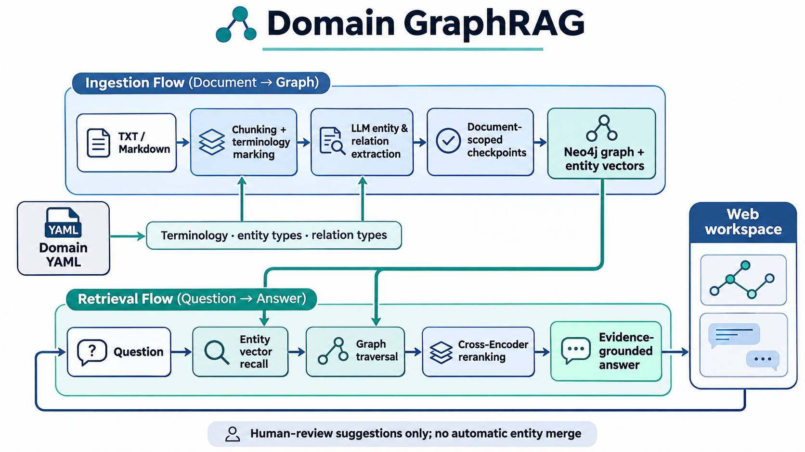

# 领域GraphRAG

**领域GraphRAG** 是一个面向领域文档的知识图谱增强问答项目。它将 TXT / Markdown 文档中的实体与关系写入 Neo4j，在回答问题时结合实体向量召回、图遍历和 Cross-Encoder 重排序，向大模型提供带来源的证据；同时提供文档入库、多会话问答和交互式图谱浏览页面。

项目提供通用工程和测井 / 石油工程两份领域配置，适合用来演示领域知识图谱与 RAG 的端到端工作流。目前定位为**本地单用户原型**，不是经过生产验证的领域问答系统。回答和抽取结果仍需结合原文核查。

## 项目能做什么

- **领域文档建图**：按段落和 Markdown 表格组织文本块；使用领域术语标记、LLM 抽取和 Pydantic 数据模型，形成实体与有向关系。
- **图谱增强问答**：用实体向量寻找入口，沿图关系检索路径，对候选路径重排序，再结合来源文本生成回答。结果中可查看路径、来源片段及重排序 / 回退状态。
- **领域配置切换**：将领域术语、实体类型提示、关系类型提示和消歧粗聚类阈值放入 YAML，修改配置即可尝试不同领域。
- **Web 知识工作台**：上传 TXT / Markdown，查看后台任务状态；管理多个持久化会话；在回答或图谱页交互查看节点、关系和来源。
- **可恢复入库**：以文档为单位保存分块和抽取检查点；失败任务可重试，不需要清理其他文档。
- **消歧建议**：CLI 可通过相似度聚类、频次和 LLM 生成候选建议；当前不会自动合并实体，Web 入库默认跳过此步骤。

## 系统架构



**入库流程**：`TXT / Markdown → 分块 → 领域术语标记 → LLM 抽取 → 文档级检查点 → Neo4j 图谱与实体向量`。任务状态和对话保存在本地 SQLite；文档检查点保存在本地文件中。Neo4j 的 `Entity` 节点保存实体，`Chunk` 保存原文片段，实体通过 `APPEARS_IN` 连接片段；`RELATES` 关系保存业务关系类型和来源块 ID。

**问答流程**：`问题 → 实体向量召回 → 固定 Cypher 图遍历 → 路径去重与 Cross-Encoder 重排 → 关联来源块 → LLM 回答`。默认保留 Top-N 路径；没有可追溯来源的路径不会用于生成回答。模型不可用时可退回入口实体向量分数，页面会显示回退状态。关键词回退是简单字符串匹配，不等同于完整的中文全文检索。

> 图中「领域术语标记」只在 YAML 的 `terminology` 非空时启用；标记是给 LLM 的提示，不会修改模型 tokenizer。重排序模型、阈值和图谱抽取质量需要在目标领域数据上评估。

## 领域适配如何实现

领域定义位于 [`domain_config/`](domain_config/)：

| 配置项 | 当前作用 |
| --- | --- |
| `terminology` | AC 自动机匹配术语并用 `【】` 标记，提示 LLM 保留术语边界；空列表时不执行标记。 |
| `entity_types` | 注入抽取提示词，作为实体分类参考；当前仍允许 LLM 自定义类型。 |
| `relation_types.mandatory` | 注入提示词，指导优先使用的关系名称。 |
| `relation_types.allow_free` | 控制提示词是否允许额外关系；当前不是代码层的严格白名单。 |
| `disambiguation.coarse_similarity_threshold` | CLI 生成消歧建议时使用的向量粗聚类阈值。 |

[`general.yaml`](domain_config/general.yaml) 是通用工程模板，默认术语列表为空；[`petroleum.yaml`](domain_config/petroleum.yaml) 提供测井和石油工程术语，例如“核磁共振测井”“潜油电泵”，以及对应实体 / 关系类型。配置示例：

```yaml
terminology:
  - 核磁共振测井
  - 潜油电泵
entity_types:
  - 测井仪器
  - 设备
  - 参数
relation_types:
  mandatory: [属于, 包含, 影响]
  allow_free: true
disambiguation:
  coarse_similarity_threshold: 0.5
```

将新文件放在 `domain_config/` 后，在 `config.yaml` 的 `domain` 字段指定文件名，并准备适合该领域的术语与问题集。**切换配置不会自动迁移或清理已有图谱**；如需隔离不同知识库，应为图名和数据目录分别配置独立值。Pydantic 当前负责字段结构校验，领域语义、关系真实性和类型约束仍依赖提示词与后续人工核验。

## 技术栈

| 部分 | 主要技术 |
| --- | --- |
| 后端 | Python、FastAPI、Pydantic、SQLite |
| 图存储 | Neo4j、参数化 Cypher、原生向量索引 / 内存回退 |
| 抽取和检索 | pyahocorasick、sentence-transformers、Cross-Encoder、LLM API |
| 前端 | React、Vite、vis-network |
| 示例 LLM | DeepSeek 兼容接口；官方 DeepSeek 地址显式关闭思维模式 |

## 快速开始

### 1. 准备环境

- Python 3.10+、Node.js / npm、Neo4j 5.x；本地演示使用过 Python 3.11 和 Neo4j Community 5.26。
- 可访问的 LLM API 和密钥。上传文档 / 提问时，相关文本会发送给配置的 LLM 服务并可能产生费用。
- 两个 sentence-transformers 模型（默认使用 CPU，首次下载需要网络）。

```powershell
git clone https://github.com/shuke-dsj/Domain-GraphRAG.git
cd Domain-GraphRAG
python -m venv .venv
.\.venv\Scripts\python -m pip install -r requirements.txt
npm --prefix web install
```

Linux / macOS 使用 `source .venv/bin/activate`，并将下面的 `.\.venv\Scripts\python` 换为 `python`。也可以通过系统已配置的 Neo4j 服务启动数据库；向量索引是否可用取决于具体 Neo4j 版本和配置。

### 2. 配置密钥与模型

```powershell
Copy-Item .env.example .env
# 编辑 .env，填写 LLM_API_KEY、NEO4J_USER、NEO4J_PASSWORD 等
.\.venv\Scripts\python src/download_model.py
```

默认模型会下载至 `models/`：`paraphrase-multilingual-MiniLM-L12-v2` 用于实体向量，`ms-marco-MiniLM-L-6-v2` 用于路径重排序。它们需要另行下载，不包含在仓库中；默认重排模型的中文表现尚未系统评测。需要更换时，在 `config.yaml` 修改模型路径、设备和检索参数。`reranker_threshold: null` 表示不使用未经校准的固定阈值。

`.env` 优先覆盖对应配置，切勿提交真实密钥。官方 DeepSeek 接口请求会设置 `thinking.type=disabled`，不把 `reasoning_content` 当作答案。其他兼容服务可能具有不同参数，需自行确认。

### 3. 构建并启动 Web 应用

```powershell
npm --prefix web run build
.\.venv\Scripts\python -m uvicorn src.web.app:app --host 127.0.0.1 --port 8000
```

打开 [http://127.0.0.1:8000](http://127.0.0.1:8000)，在「文档管理」上传 [`examples/工程知识示例.md`](examples/工程知识示例.md)，等待入库完成；再在「知识问答」新建会话，或在「知识图谱」搜索“砂岩”。更多问题见 [`examples/演示问题.md`](examples/演示问题.md)。前端开发可运行 `npm --prefix web run dev`，Vite 会将 `/api` 代理到本机 8000 端口。

### 4. 命令行

```powershell
# TXT / Markdown 入库；默认生成消歧建议但不会执行合并
.\.venv\Scripts\python main.py ingest -f "examples/工程知识示例.md" --skip-resolution
.\.venv\Scripts\python main.py query -q "砂岩为什么可以作为储层岩石？" -v
```

也支持 `--text` 和 `--text_dir`；CLI 的 `--skip-resolution` 跳过消歧建议。PDF OCR 是独立预处理工具，Web 当前不直接接收 PDF；使用 OCR 需另装 `PyMuPDF`、`PyPDF2`、`pillow`、`pytesseract` 和系统 Tesseract。

## 项目结构

```text
Domain-GraphRAG/
├── domain_config/       # 领域术语、实体/关系提示、消歧配置
├── docs/                # 架构图
├── examples/            # 可公开演示的示例文档和问题
├── src/
│   ├── extraction/      # 分块、术语边界标记、LLM 抽取与结构校验
│   ├── resolution/      # 候选聚类、频次和 LLM 消歧建议
│   ├── storage/         # Neo4j 图构建、向量索引
│   ├── retrieval/       # 固定 Cypher、混合召回与重排序
│   ├── pipeline/        # 入库、问答和对话编排
│   ├── llm/             # LLM 适配器
│   ├── web/             # FastAPI 文档、任务、会话和图谱接口
│   └── utils/           # 可选 PDF 预处理工具
├── tests/               # 模块 / API 测试和手动验证脚本
├── web/                 # React 工作台
├── main.py              # CLI
├── config.yaml          # 非敏感配置
└── .env.example         # 密钥配置模板
```

`data/`、`models/`、`output/`、`extracted/`、日志、`.env` 和本地资料不进入公开仓库。文档及会话内容存储在本机，原始文档和模型输出也可能出现在本地运行日志；使用真实数据时请自行管理访问与保留周期。

## 验证与现有限制

```powershell
.\.venv\Scripts\python -m unittest discover -s tests -v
npm --prefix web run build
```

模块 / API 测试使用模拟依赖，不代表真实 LLM 质量。示例文档曾用于本地 Neo4j 和真实 LLM 的手动验证，但这不是长期质量评估。完整 PDF 入库由使用者手动测试。

- 原生 Neo4j 向量检索不可用或跨图过滤后候选不足时，可能回退为内存余弦检索；大图的性能需要单独评估。
- 来源块 ID 支持定位原文，但不等于逐句事实核验；LLM 仍可能出现抽取错误或无依据推断。
- 多轮对话目前采用基于最近实体的简单指代替换，不是完整对话理解；会话存于本地 SQLite。
- 图谱概览最多展示 80 个实体；可通过名称搜索进入实体邻域。
- 自动实体合并目前禁用；CLI 消歧结果仅为建议，尚无完整审核 / 合并工作流。
- 系统不含多用户认证、权限控制或公网部署防护；请保持默认本机监听。
